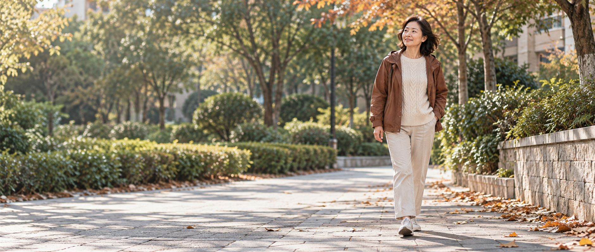
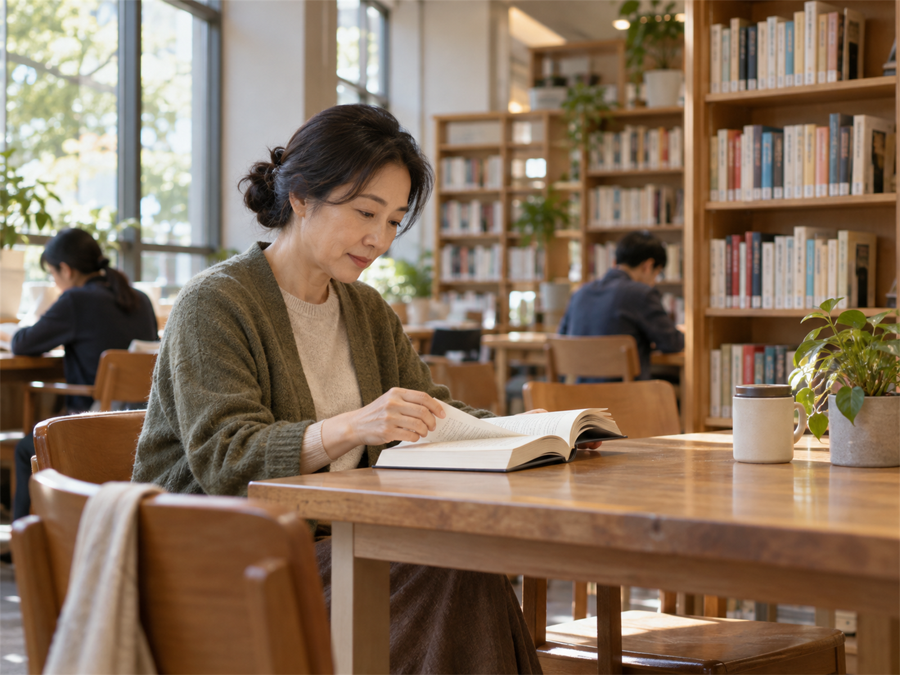
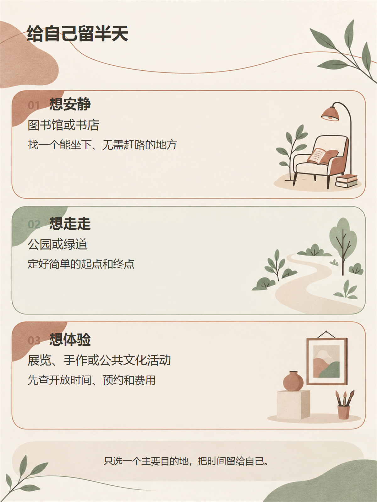

有时候，周末终于空出半天，反而不知道怎么安排。

不想赶路，不想挤热门景点，也不想为了“过得充实”把行程排满。可在家随手刷一会儿手机，两个小时很快就过去了。等到天色变了，才想起自己原本也想出去透透气。

在家休息当然不算浪费。只是当你确实想换个环境，又没有一整天的时间，不妨把范围缩小一点：就在家附近，选一件自己真正愿意做的小事。

10月10日，人民网转述了抖音生活服务发布的《2026中秋国庆消费报告》。报告显示，在该平台观察到的假期消费中，本地休闲与长线游都受到关注。这只是一份特定平台的假期报告，不能代表每个人，却也提醒我们：休闲不一定非要去很远的地方。

如果手里只有两三个小时，可以先问问自己：今天更想安静一会儿、走一走，还是体验一点新鲜的东西？

## 想安静，就找个能坐下来的地方

想安静时，目的地不必特别有名。附近的公共图书馆、能慢慢翻书的书店，或一处允许人安静停留的公共空间，都可以成为半天的去处。

选择时，先别急着看“是否适合拍照”，而是看三个实际条件：路上是否省事，到达后有没有可坐的地方，开放时段是否合适。可以在地图上把范围定在不用多次换乘、不会把大半时间花在路上的区域，再通过官方渠道确认开放时间、入馆要求或座位情况。

到了以后，也不必规定自己读完多少页。翻一本感兴趣的书，抄下一段想记住的话，或者只是坐在窗边看看街景，都算是这段时间的内容。没有买书、没有点一杯饮料，也不影响这次出门成立。

如果附近正好有这样的地方，可以先在地图里存下来，顺手记下开放时间。以后临时空出半天，就不必再花很久寻找去处。

## 想走一走，就去熟悉的地方看看秋天

秋天不只在远方的山林里。不同城市的秋意来得早晚不一，也许是树叶开始变色，也许只是风没那么闷、傍晚的光线柔和了一点。附近的公园、城市绿道，或一段安全、适合步行的公共空间，都值得重新走一遍。

散步不用变成运动任务。出门前给自己定一个简单的起点和终点，比如从公园入口走到湖边，或者沿绿道走到下一处出口。路线要和当天的体力相配，沿途最好有可以休息或提前离开的地方；走到觉得合适，就可以折返。

真正准备出门时，再看一眼天气和开放情况，选一条照明、通行条件较稳妥的路线。天气不好、路面湿滑或身体状态不合适，换一天也没关系。

## 想有点新鲜感，就试一次新的体验

有时想出门，不是为了安静，也不是为了多走几步，只是想让这个周末和往常有一点不同。

可以看看附近有没有小型展览、公共文化活动，或自己感兴趣的简单手作体验。它不必成为一门长期课程，也不必为了“来都来了”顺便买一堆材料。先选真正好奇的一项，再决定愿意付出多少时间和费用。

如果活动需要预约，别只看转发海报。报名以前，尽量到主办方或场馆的正式页面确认日期、营业时间、地址、预约方式、费用和取消规则；免费活动也要看看是否限额。第一次尝试，可以选流程简单、时长容易掌握的项目，给自己保留调整的余地。

平时看到感兴趣的展览或体验，可以随手记下两三项。真有空时，再从中挑一个距离、时间和预算都合适的，不用为了完成清单专门凑行程。

## 怎样真正安排一个舒服的半天

半天不长，安排得少一点，反而更从容。

1. **只选一个主要目的地。**去书店，就让逛书店成为主事；去公园，就不必再赶下一处景点。
2. **尽量缩短往返路程。**少换乘、少绕路，把时间留给真正想做的事。
3. **出发前确认几件实事。**开放时间、交通、天气和费用先看清，也允许自己根据当天状态改变计划。

比如，给自己留一个下午去附近的图书馆：

- **出门前：**确认开放时间和天气，选一条不用反复换乘的路线。
- **到达后：**找一本感兴趣的书，安静坐一会儿，不规定必须读完多少。
- **回家时：**状态不错，就沿熟悉的街道慢慢走一段；觉得累了，就按方便的方式回去，不再临时增加下一站。

这只是一个参考，不是必须照着完成的时间表。中间多停一会儿，或者提早结束，都没有关系。

不是每个周末都要过得充实。想出去时，家门口也能有一段属于自己的时间；想留在家里，什么都不安排，也是一种认真休息。

自己喜欢怎样度过半天，本身就值得由自己决定。

**烟火有主意**  
**自己的日子，自己有主意。**

如果这个周末能给自己留半天，你最想做什么？

---

**资料来源：**

- [人民网：《抖音生活服务发布中秋国庆消费报告》（2026年10月10日）](https://finance.people.com.cn/n1/2026/1010/c1004-40811939.html)

