# 五组中年成长贴图与发布文案

每组3张，按01、02、03顺序上传。01是含具体方法的贴图封面；02给完整案例；03给可复用模板。最终图片尺寸1080×1440。以下标题、内容介绍和发布正文可分别复制使用。

选题来自X榜单需求线索，工作场景、案例和话术均为原创；各组制作来源另存在对应的标题与内容介绍文件中。

## 40岁想学点新东西，先别急着买课

[打开本组图片与文案](../40岁想学点新东西先别急着买课/公众号贴图/标题与内容介绍.md)

### 内容介绍

想跟上变化，又怕花了钱没学会？先从手头的一件事找学习入口。3 张贴图，用一张报表示范怎样选任务、练出成果，再判断需不需要买课。

### 发布正文

一看到新工具、新技能，就担心自己落后。买课时觉得终于开始了，可下班之后打开目录，几十节课看着就累。

可以先换个入口：最近哪件工作最费劲？比如每周都要整理好几份表，就先学会把它们汇总成一张能复用的表。遇到哪里不会，再找对应的资料。做出第一版，拿新数据再跑一次，才知道自己到底学会了多少。

真要买课，先看它能不能帮你完成这个任务，有没有练习和反馈，前置基础是否合适。工作资料涉及客户、金额或个人信息时，用虚构数据练习。

你现在最想学会的技能，准备先用在哪件具体的事上？

#中年成长 #学习方法 #职场技能 #烟火有主意

### 图片顺序

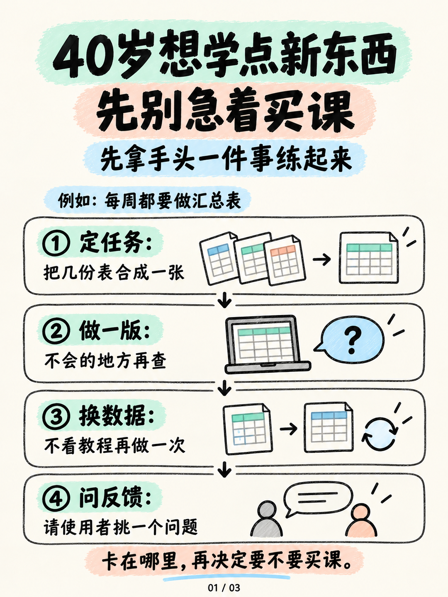

[打开原图](../40岁想学点新东西先别急着买课/公众号贴图/01-cover.png)

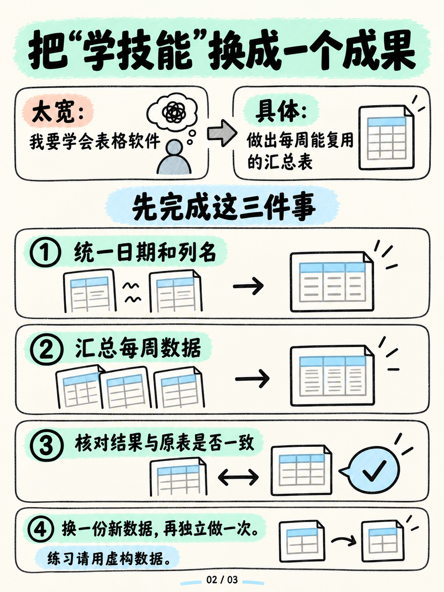

[打开原图](../40岁想学点新东西先别急着买课/公众号贴图/02-example.png)

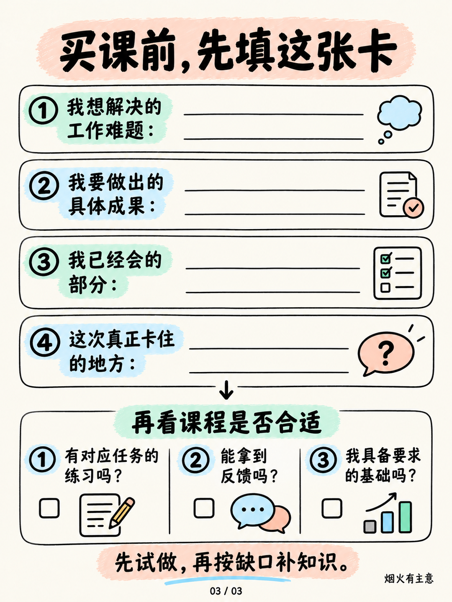

[打开原图](../40岁想学点新东西先别急着买课/公众号贴图/03-template.png)

## 别人一句“你看着办”，别急着埋头干

[打开本组图片与文案](../别人一句你看着办别急着埋头干/公众号贴图/标题与内容介绍.md)

### 内容介绍

接到一句“你看着办”，最怕做完才发现方向不对。这组 3 张图给你四句澄清话术、一段完整对话和一份确认消息模板。

### 发布正文

“你看着办”有时是信任，有时只是要求还没说完整。拿不准就埋头做，往往做到一半才发现，用途、形式甚至时间都想岔了。

不用一口气问一长串。先问最影响做法的一项：“这份材料是给内部选方案，还是给客户看？”用途清楚了，再补上形式、时间和优先级。对方已经讲清的，就不用重复问。

最后用一条简短消息把交付约定发回去，给对方一个纠正误解的机会。要求有变化，也及时同步。问清楚不能消除所有返工，但能让双方早点发现是不是在做同一件事。

你最难问出口的，是要做成什么样，还是到底什么时候要？

#职场沟通 #工作方法 #中年职场 #烟火有主意

### 图片顺序

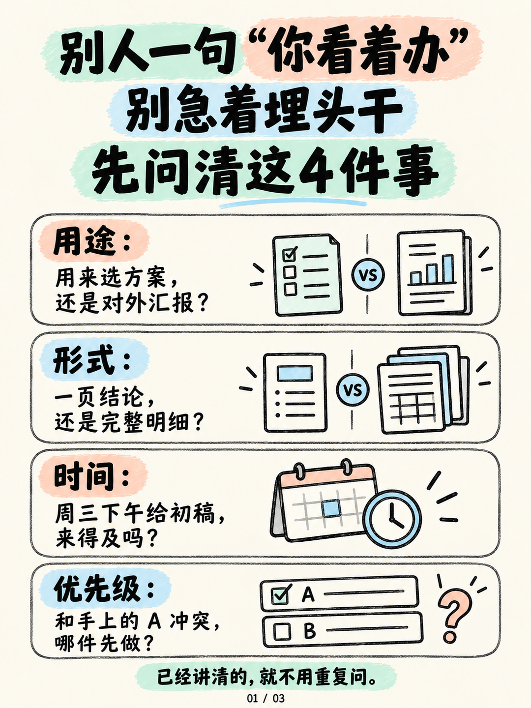

[打开原图](../别人一句你看着办别急着埋头干/公众号贴图/01-cover.png)

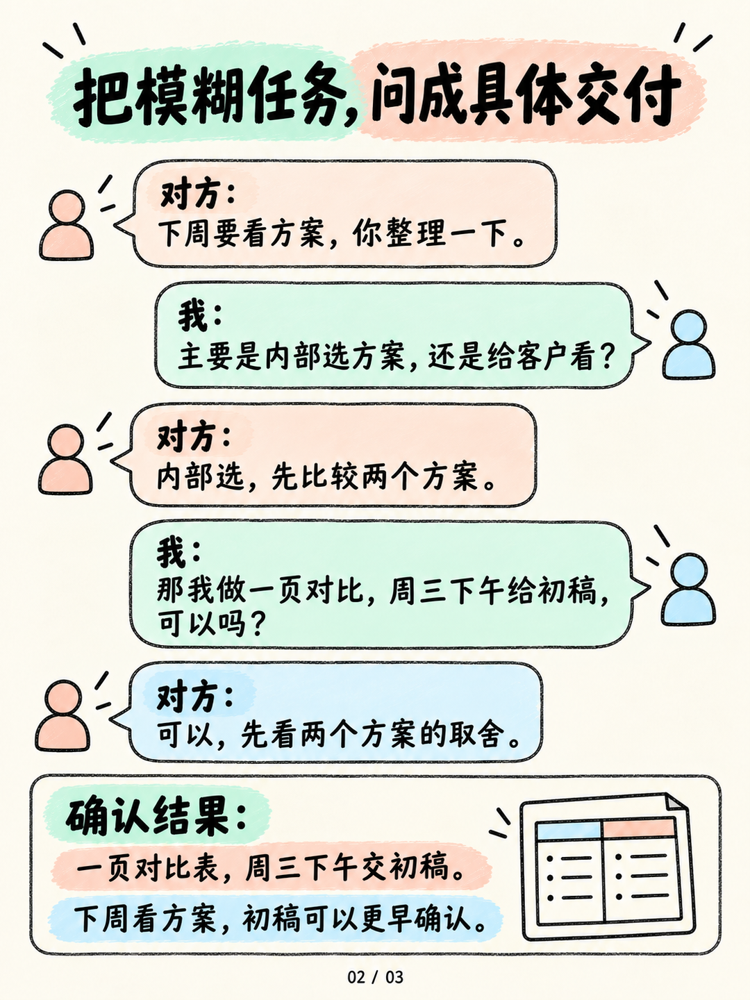

[打开原图](../别人一句你看着办别急着埋头干/公众号贴图/02-dialogue.png)

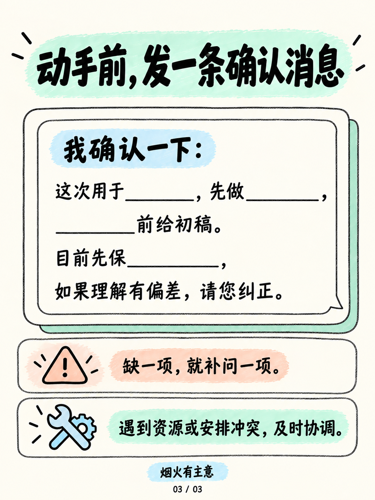

[打开原图](../别人一句你看着办别急着埋头干/公众号贴图/03-template.png)

## 想改变，又不知道往哪走？先列这三张清单

[打开本组图片与文案](../想改变又不知道往哪走先列三张清单/公众号贴图/标题与内容介绍.md)

### 内容介绍

方向没想清，不必先做一个很大的决定。3 张贴图，把已有能力、真实需求和可投入的时间放到一起，再设计一个两周能完成的小尝试。

### 发布正文

想改变的时候，很容易先问自己：“我到底适合做什么？”这个问题太大，想了一晚上，也未必能多出一个答案。

不妨先写小一点：别人常因为什么来找你，你反复见过哪些没有解决好的问题，你现在每周还能拿出多少时间。三张清单放在一起，可能就能找出一件值得试做的小事。

比如你擅长整理流程，同事总问相同的入职问题，就试着做一页入职指引，找真正用得上的人试读。两周后看它有没有帮到人、哪里需要改、自己愿不愿意继续做。效果不合适，就缩小或换一个问题。

这个尝试可以在现有工作里完成，别急着让它承担转行或赚钱的全部期待。你最常被别人请教的，是哪一件事？

#中年成长 #寻找方向 #职业发展 #烟火有主意

### 图片顺序

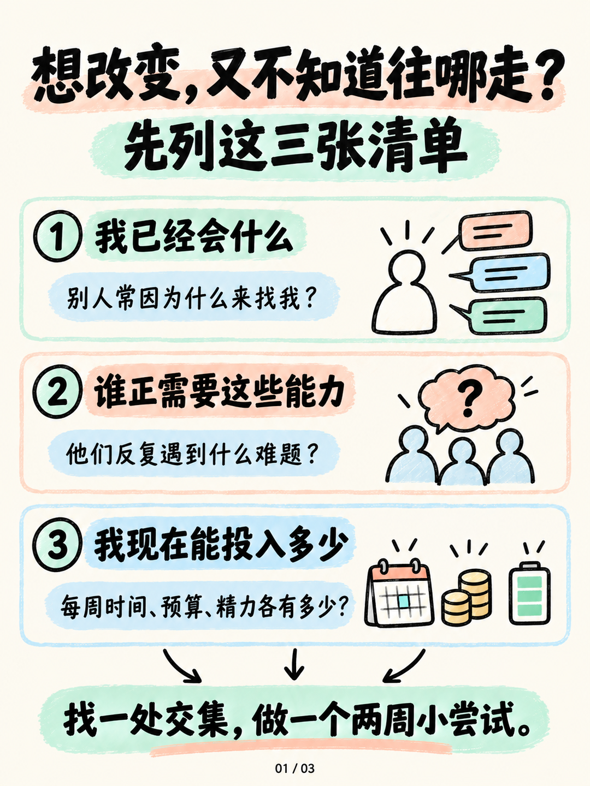

[打开原图](../想改变又不知道往哪走先列三张清单/公众号贴图/01-cover.png)

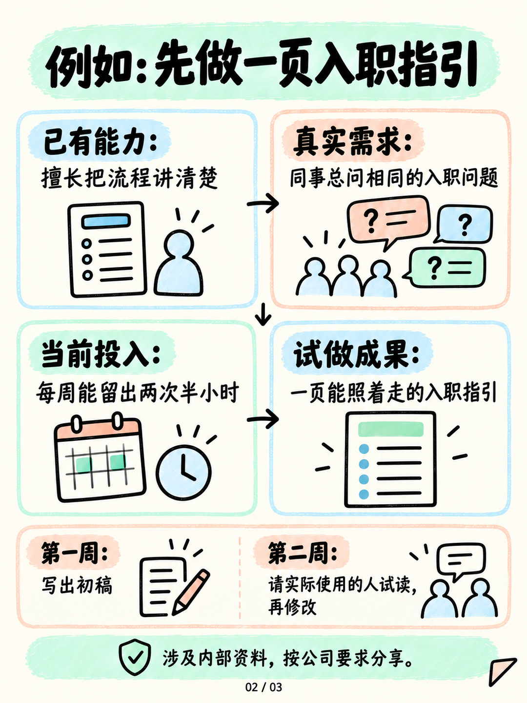

[打开原图](../想改变又不知道往哪走先列三张清单/公众号贴图/02-example.png)

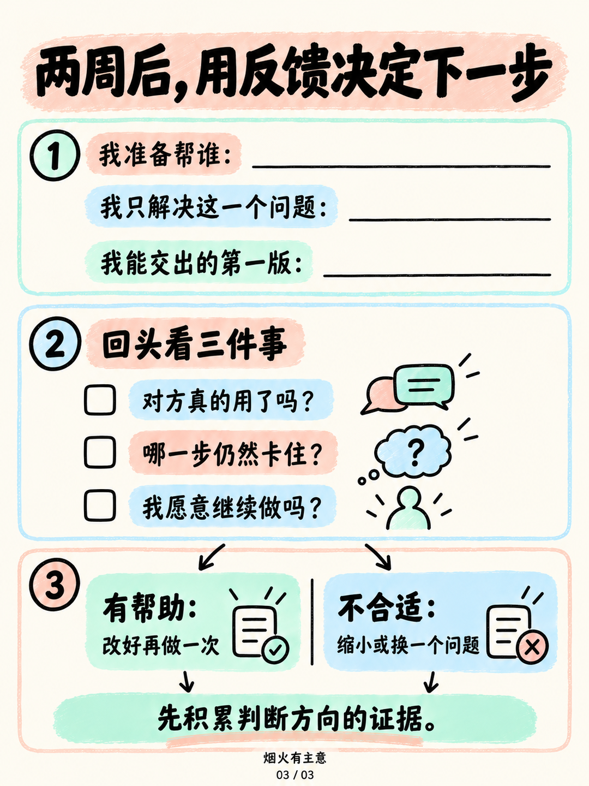

[打开原图](../想改变又不知道往哪走先列三张清单/公众号贴图/03-template.png)

## 一想到要学半小时，就一直拖到明天

[打开本组图片与文案](../一想到要学半小时就一直拖到明天/公众号贴图/标题与内容介绍.md)

### 内容介绍

下班后打开学习计划，却迟迟没有开始。3 张贴图示范怎样把一大段学习改成一个能完成的小动作，给忙碌日也留下一点进度。

### 发布正文

下班回家，想到还要学半小时，心里先往后退了一步。不是今天太晚，就是明天可能更有精神，计划就这样一天天留在原地。

可以把今晚的任务改得具体一点：“打开昨天那张练习表，把日期统一好，保存一份。”不用等到时间充裕，也先别把完整章节都摆在眼前。做完一个动作，就留下一个看得见的结果，下次从这里接着来。

有余力可以继续，累了就按事先约好的地方停。真需要休息的晚上，也可以休息。小步骤的用处，是让你更容易接上学习，不是再给自己加一条必须做到的要求。

你一直拖着没开始的那件事，今晚能缩成哪一个动作？

#学习方法 #行动起来 #中年成长 #烟火有主意

### 图片顺序

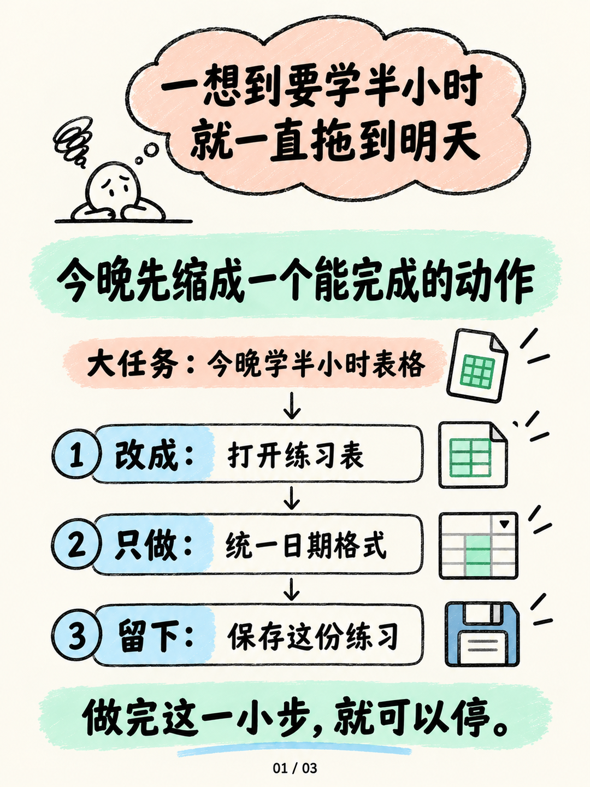

[打开原图](../一想到要学半小时就一直拖到明天/公众号贴图/01-cover.png)

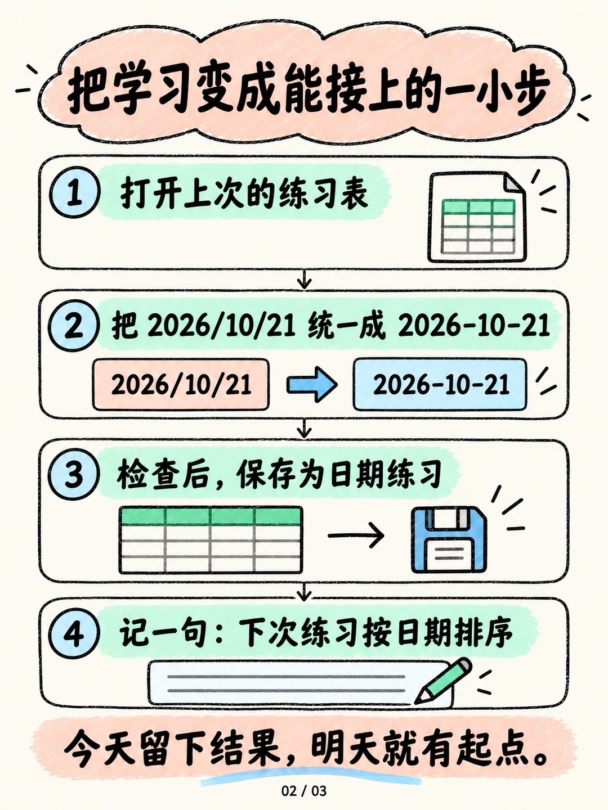

[打开原图](../一想到要学半小时就一直拖到明天/公众号贴图/02-example.png)

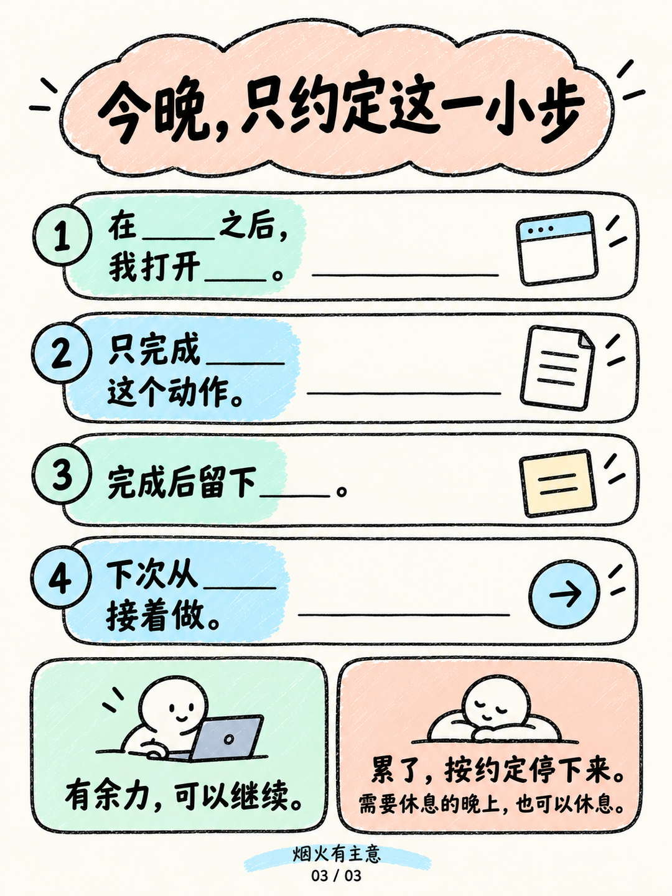

[打开原图](../一想到要学半小时就一直拖到明天/公众号贴图/03-template.png)

## 同样的错犯了三次，怎么复盘才有用？

[打开本组图片与文案](../同样的错犯了三次怎么复盘才有用/公众号贴图/标题与内容介绍.md)

### 内容介绍

复盘最后只写“下次认真一点”，很难改变下一次的做法。3 张贴图，用一次材料延期示范怎样找到差异、改一个动作，再看有没有改善。

### 发布正文

忙完一个项目，复盘常常只剩几句话：沟通不够、时间没安排好、下次再认真一点。问题听起来都对，可下一次一忙，还是照旧。

试着留下四件具体的事：原本约定什么，实际发生什么，差异出现在哪一步，下次准备改哪个动作。比如约好周三交完整材料，到了周四还缺一张表。再往前找，发现截止前没有确认那张表由谁提供、何时能到。

下一次就提前确认负责人与时间，到约定节点仍没拿到时及时同步。之后再看材料是否更齐、有没有更早发现风险。如果是人手或权限不足，也要把需要协调的条件写出来。

复盘不必一次改完所有问题。你最近一次想写“下次注意”的地方，能不能换成一个具体动作？

#工作复盘 #职场成长 #工作方法 #烟火有主意

### 图片顺序

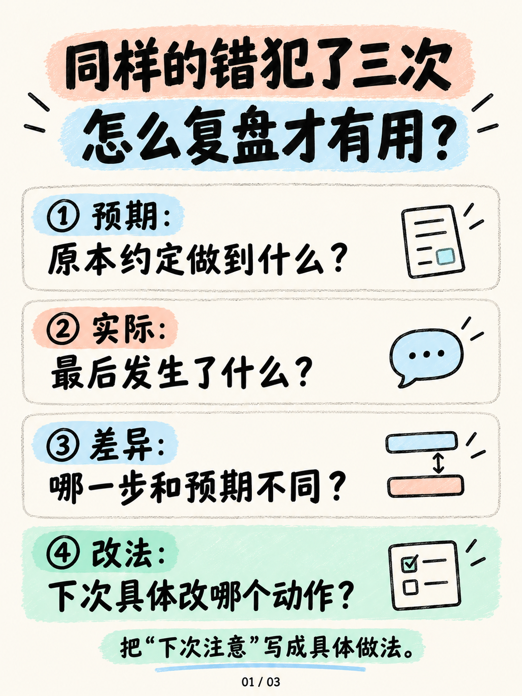

[打开原图](../同样的错犯了三次怎么复盘才有用/公众号贴图/01-cover.png)

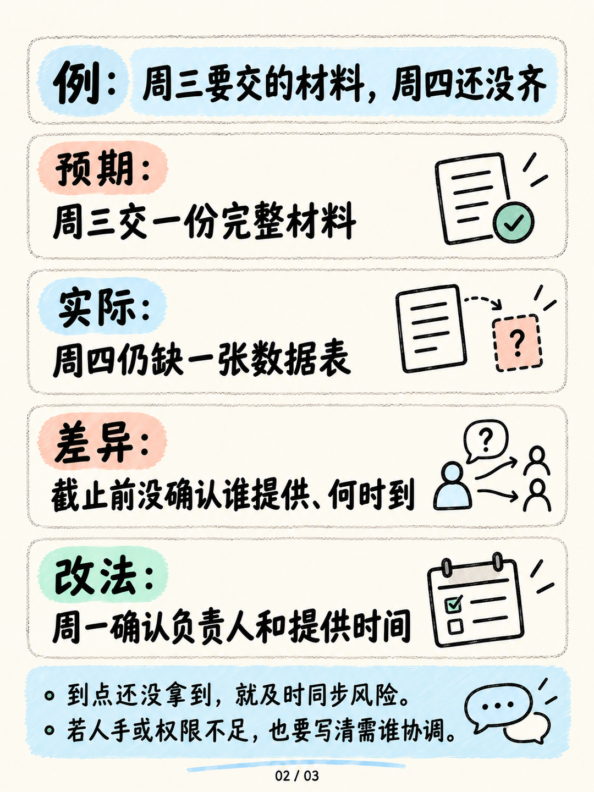

[打开原图](../同样的错犯了三次怎么复盘才有用/公众号贴图/02-example.png)

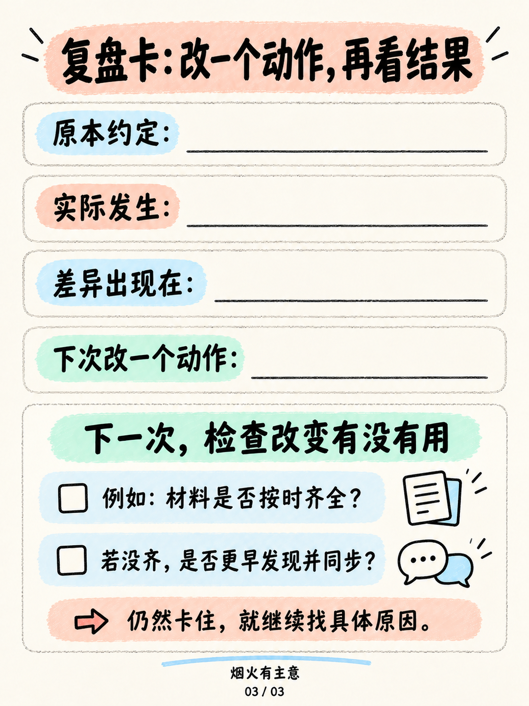

[打开原图](../同样的错犯了三次怎么复盘才有用/公众号贴图/03-template.png)
